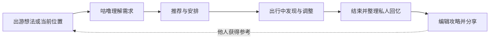

# Funny+ AI Native MVP 产品方案

> **状态**：当前 MVP 以已经在产品里的 A 版为准。从第三节起是下一阶段讨论稿，不作为当前验收缺口。
>
> **当前 MVP**：重庆、成都、北京的 1–2 天出游。发现 → 填写需求 → 比较方案 → 行程工作台（按天修改、预算、路线、避坑）→ 本机保存。咕噜可以对话生成方案，修改先预览再确认。定位到城市，用来选择出发城市。
>
> **当前不做**：账号与跨设备同步、到达判断与现场推荐、下一站交通、按剩余小时的临时规划、旅行回忆、攻略分享快照。这些留在下文，等 A 版验证后再决定是否纳入。
>
> **依据**：`PRODUCT.md`、`docs/product-plan.md`，以及 2026-11 对工作区的核对。旧的「冲突时以本文覆盖 A 版范围」不再适用。

## 一、产品定位与目标

以下各节是下一阶段要验证的旅程。当前验收仍按文首的 A 版：三个城市、1–2 天、本机行程、城市级定位。

Funny+ 是一个 AI 旅行助理。咕噜陪用户从出发前构想到旅途中的临时决定，结合旅行上下文提供规划、推荐、避坑和调整建议，帮助用户做出适合当下的选择。

MVP 要验证：用户是否愿意让咕噜贯穿一次北京旅行，完成「规划或临时安排 → 现场发现与调整 → 保存回忆 → 整理分享攻略」。

用户可以提前做详细计划，也可以到达目的地后临时安排；同一个人可以随时切换习惯，不要求选择 P 人或 J 人模式。产品支持固定安排和灵活备选并存。

## 二、首版范围与产品原则

| 维度 | MVP 口径 |
| --- | --- |
| 目的地 | 北京为样板；具体开放地点以数据核验结果为准。 |
| 使用场景 | 提前规划半天至 2 天；已在目的地时规划接下来几小时；途中调整。 |
| 入口 | 首页咕噜迎接，提供自然语言入口、当前旅行和少量启发内容。 |
| 账号 | 旅行、回忆、照片、收藏跟随账号；同一账号换设备可找回。登录方式待选。 |
| 旅行结果 | 私人保存为旅行回忆；用户可将选定内容整理为攻略并分享。 |
| 推荐范围 | 目标涵盖吃、拍、买、玩与避坑；首发至少一类现场内容须有可信数据，其余以盘点结果决定。 |

**原则**：旅行上下文是产品的共同状态；咕噜帮助理解、建议和操作，结构化界面展示安排与取舍。计划可以不完整；不确定信息明确标注；影响已确认安排的修改由用户确认；私人回忆默认不公开。

## 三、核心旅程

### 3.1 提前规划

用户说「周末带爸妈在北京玩两天，不想走太多路」。咕噜提取已有信息，只追问影响当前规划的必要问题；信息足够时给出路线、安排理由、费用依据与待确认项。用户可通过对话或工作台修改、固定安排，确认后保存。

### 3.2 当地临时规划

用户说「我在前门附近，下午有四小时，想吃点东西、逛一逛」。用户授权定位或手动指定地点；咕噜根据位置、剩余时间、偏好及可获得的数据推荐选择。用户可以只选一个地点，也可以先保存备选，不必生成精确时间表。

### 3.3 到达、推荐与继续旅程

| 条件 | 产品行为 |
| --- | --- |
| 计划了地点，当前位置与地点匹配 | 在产品内主动展示少量相关推荐与注意事项。 |
| 计划了地点，但当前位置不在该地点 | 先询问是否查看该地点的推荐。 |
| 定位不可用、不准确或无法判断 | 不假定到达；用户可手动指定位置或确认到达。 |

位置匹配应考虑地点范围及定位精度，具体阈值待验证；定位推断与用户确认分开记录。MVP 的主动展示指应用内展示，不默认包含后台持续定位或推送；提醒频率及关闭方式需在交互设计中落实。

用户说「这里没什么可玩的」时，咕噜先辨别是想继续探索还是离开；用户决定去下一站后，展示可获得的交通方式、预计时间、费用或未知项，以及对后续安排的影响。仅询问不改变计划；用户确认后应用变更。无可用交通数据时如实说明，不伪装实时结果。

### 3.4 回忆与攻略

用户主动结束旅行后，咕噜基于已有记录生成可编辑的私人回顾草稿。用户可补充文字、照片和地点体验；未确认的计划不能写成实际到访，模型不能编造感受。

用户想分享时，可从自己的记录生成独立的攻略草稿，编辑路线、体验、推荐与避坑内容，选择照片及其他公开信息，预览确认后生成只读分享页。攻略区分用户亲历与咕噜补充建议；缺少依据的事实不生成。

分享采用确认时的快照：私人回忆后续修改不自动改变已发布攻略，用户可更新发布或取消分享。精确位置历史、同行人信息、私人备注和费用等不默认公开，由用户选择。

## 四、功能需求与验收

| 编号 | 功能 | MVP 要求 | 验收示例 |
| --- | --- | --- | --- |
| F01 | 首页与咕噜 | 显示自然语言入口、当前旅行和场景引导；无旅行时可直接提出需求。 | 新用户可从提前规划或当地临时安排进入同一助理。 |
| F02 | 旅行上下文 | 保存目的地、日期或时间范围、同行人、偏好、安排及状态；允许未知与备选。 | 对话中确认的安排与工作台一致；固定安排在后续调整中作为约束。 |
| F03 | 规划与修改 | 生成结构化安排；理解自然语言修改，展示受影响内容并在必要确认后执行。 | 「第二天下午轻松点」作用于指定时段；确认前原计划不变。 |
| F04 | 现场推荐 | 按 3.3 的定位与确认规则展示或询问；至少一类推荐数据可用。 | 已计划且定位匹配时出现相关推荐；位置不可用时可手动确认。 |
| F05 | 下一站 | 理解离开意图，确认下一站，展示可获得的交通、时间、费用和影响。 | 用户确认后更新安排；查询失败时说明缺口，不修改行程。 |
| F06 | 账号与同步 | 用户数据归属账号；行程、回忆、照片和收藏可跨设备找回；数据访问按账号授权。 | 设备 A 保存后，设备 B 登录同账号可查看；其他账号不可访问私人内容。 |
| F07 | 收藏与回忆 | 保存旅行卡片，支持收藏、结束旅行、文字与照片记录和可编辑回顾。 | 重新登录可找回卡片及记录；计划和实际经历可区分。 |
| F08 | 攻略与分享 | 从用户选定内容生成、编辑、预览、发布只读攻略；可更新或取消。 | 未选中的私人内容不出现在分享页；取消后分享链接不可访问。 |
| F09 | 可信与失败处理 | 关键事实展示来源或状态、适用时间及未知项；AI 或外部服务失败时明确说明。 | 未知票价不写成免费；失败不覆盖或丢失已保存行程。 |
| F10 | 评估 | 记录核心任务、建议采纳、修改确认、失败及数据缺口；收集测试反馈。 | 能按两条旅程统计完成与中断环节，并排查失败原因。 |

## 五、AI 与系统的职责

| 角色 | 职责 |
| --- | --- |
| 咕噜 | 理解需求与上下文、适时追问、提出方案与解释、生成可编辑的回顾和攻略草稿。 |
| 工具与数据 | 提供地点、营业信息、交通、推荐和避坑事实，附来源、更新时间、适用范围或缺失状态。 |
| 业务系统 | 持有旅行和账号状态，执行经过校验与确认的操作，计算可计算的时间、费用和影响，记录变更。 |
| 用户 | 决定偏好和取舍，确认重要修改、实际经历及公开内容。 |

长期偏好、单次旅行要求和临时状态应区分；推测不能冒充用户明确表达。位置应由用户授权或手动提供；用户应能管理自己的记录与分享。具体数据保留、删除和授权文案在实施前补齐。

## 六、首版验收任务

**任务 A｜提前规划并在途中调整**：同一账号创建北京行程 → 自然语言修改 → 到达计划地点并获得符合状态的推荐 → 表达提前离开 → 查看下一站交通及影响并确认 → 结束旅行、添加图文 → 编辑并分享攻略。

**任务 B｜当地临时规划**：用户提供或手动指定北京位置和剩余时间 → 咕噜推荐可选活动 → 用户选择并形成安排 → 后续继续修改 → 换设备登录后找回。

两项任务均需覆盖：数据不足、位置不可用、模型或外部服务失败、取消修改，以及私人内容不被意外分享。真实用户测试应观察任务完成、建议是否有用、理解依据、修改是否正确，以及保存与分享意愿；首轮先建立基线，不预设未经验证的数值目标。

## 七、现状、依赖与待决事项

**现有基础**：仓库已有结构化行程、预算与规则引擎、北京地点和避坑数据，以及模型对话入口。登录兑换仍为占位；用户行程主要存本机，服务端行程接口目前只读。上述为初步代码核对，完整差距分析另做。

| 待决事项 | 下一步 |
| --- | --- |
| 北京具体覆盖区域与推荐类别 | 盘点地点、餐饮、拍照、商品、营业与交通数据的覆盖、来源、时效和授权，选定样板区域。 |
| 登录方式和首发平台 | 结合平台能力、接入资质和成本确定；设计登录前体验及已有本地数据迁移。 |
| 位置与到达判定 | 明确定位授权、地点范围、精度不足时的确认交互和主动推荐频率。 |
| 数据与第三方服务 | 核验路线、位置、照片存储及内容来源的可用性、费用、授权、更新和失败处理。 |
| 安排与确认规则 | 明确哪些操作需预览确认、如何撤销，以及跨设备并发修改如何处理。 |
| 分享与内容治理 | 明确分享链接访问、撤销、照片与攻略的删除、用户内容和推广标识规则。 |
| 指标与发布门槛 | 通过样板测试建立完成率、推荐采纳、修改成功与数据缺口基线后确定目标。 |

**暂不纳入 MVP**：机酒预订与支付、复杂多人协作、完整社交评论体系、多城复杂旅行，以及基于他人攻略一键重新规划。是否加入其他能力，以验证核心旅程的必要性和数据可行性为准。

## 八、建议推进顺序

1. 盘点北京样板区域与数据供给，明确两个验收任务可用的地点和推荐内容。
2. 设计首页、对话、旅行工作台、现场推荐、回忆和攻略分享的端到端体验。
3. 定义账号与旅行状态、AI 动作和确认、事实来源、照片与分享的契约，对照现有实现拆解差距。
4. 构建可运行的完整链路，先做小范围真实用户测试，再根据证据扩展内容和城市。

## 九、MVP 需求细节（讨论稿）

本章将已讨论方向展开为可设计、可验收的场景。「已确认」指本次对话中用户确认的产品方向；「建议」是为让体验可落地提出的方案，仍需评审，不能视为已确认规则。

### 9.1 首页与旅行入口

**已确认**：首页由咕噜迎接，同时提供自然语言入口、当前旅行和启发性推荐；用户既可提前规划，也可到当地后临时规划。

**建议交互**：没有旅行时，展示「规划一次旅行」和「我在这里，接下来做什么」等示例；有旅行时展示当前旅行卡片。示例是快捷入口，不要求用户选择固定模式。用户可以直接输入需求，也可以先查看旅行内容。

**验收**：新用户可从首页说出出游需求；已有用户可打开当前旅行并继续与咕噜讨论；两种入口产生的已确认安排均显示在同一旅行工作台。

### 9.2 提前规划与自然语言修改

**已确认**：咕噜理解同行人、偏好和限制，帮助形成可执行的计划；用户可用自然语言调整，也可固定重要安排。详细计划与灵活备选可以并存。

**建议交互**：咕噜先使用用户已提供的信息，仅追问会影响当前方案的缺项；用户暂时不知道的内容可以留空并说明假设。方案展示地点顺序、时间或时段、推荐理由、费用依据、风险与待确认事项；没有可靠数据的部分标注未知。

用户说「第二天下午轻松点」时，咕噜结合当前行程提出具体变化，说明受影响的地点、时间和可计算费用；用户确认后更新。意思不清时先追问，不擅自改变已确认安排。

**验收**：用户能够从自然语言需求生成并保存北京行程；对指定天提出修改时，预览清楚显示变化，取消后原计划不变，确认后对话与工作台一致；未知票价不被写成免费。

### 9.3 当地临时规划

**已确认**：用户可以从当前位置和剩余时间出发获取临时安排，不必先创建完整旅行，也可以手动提供位置。

**建议交互**：用户提供城市、商圈或地点及可用时间后，咕噜利用可获得的数据给出适合的候选，说明理由和必要的不确定性；用户可选一个地点、收藏候选或形成一段灵活安排。位置精度不够时，不展示无法支持的精确距离。

**验收**：不授权定位也可通过手动指定地点继续；用户选择候选后，它进入当前旅行上下文，后续对话能引用并修改该安排。

### 9.4 到达与现场推荐

**已确认**：用户计划了地点且定位在该地点时主动推荐；不在该地点时询问是否查看推荐。推荐目标包括美食、拍照地点、网红或特色商品等。

**建议交互**：应用内先展示少量推荐，用户可继续询问、收藏或加入行程；对于地点类推荐，尽可能说明为何适合当前用户、位置、可用时间、营业信息与数据状态。热门程度、排队、价格等缺少可靠依据时明确未知；推广内容需标识。没有定位或判断不准时，允许用户手动指定或确认到达。

**验收**：计划地点与位置匹配时展示该地点相关推荐；不匹配时先询问，不冒充用户已经到达；拒绝定位后仍能手动继续；用户选择加入行程的内容与工作台一致。北京首发类别和样板区域以数据核验为准。

### 9.5 提前离开与前往下一站

**已确认**：咕噜应通过交互捕捉用户不想继续停留的想法，帮助规划下一站的交通、时间等。

**建议交互**：

1. 用户说「没什么可玩」，意图不明确时询问是继续探索还是离开；用户明确说「去下一站」时无需重复确认离开意图。
2. 有原定下一站时展示该地点，也允许用户选择其他地点；没有下一站时可先推荐候选。
3. 用户选择目的地后，展示可获得的交通方式、步行或换乘、预计时间、费用或未知项，并说明对后续安排、预约及空档的已知影响。
4. 仅查看建议不修改行程；用户确认具体变更后更新。定位、路线或价格不可用时提供手动输入或明确缺口，不虚构实时数据。

**验收**：模糊表达可澄清，明确表达能进入下一步；有无原定下一站均有可继续的交互；取消变更保留原计划，确认后影响同步到工作台。

### 9.6 旅行卡片、收藏和账号

**已确认**：旅行可以保存为卡片和收藏；旅行、回忆、照片和收藏跟随用户账号，换设备可找回。

**建议交互**：「我的旅行」按计划中、旅行中、已结束展示卡片，分别突出目的地与时间、当前或下一安排、旅行封面与记录；保存保证旅行可找回，收藏帮助挑出用户特别想保留的旅行。用户主动结束旅行后仍可编辑回忆。允许先体验，云端保存前引导登录；登录方式、本机旧数据迁移与登录前草稿保留方式待定。

**验收**：用户可保存、查看和收藏旅行；同一账号换设备可找回旅行、收藏和已保存的图文；其他账号不能读取私人数据。保存或上传失败时有明确状态，不显示为成功。

### 9.7 旅行回忆

**已确认**：用户保存的是私人旅行回忆，可在行程中加入自己的内容；每次行程结束后可复盘。

**建议交互**：用户结束旅行后，咕噜按时间或地点整理可编辑草稿，区分原计划、用户确认过的到访和其他记录；用户可给整趟旅行或具体地点添加照片、文字、感受及避坑心得，也可以稍后补充或删除。数据缺失时留空或邀请用户补充，不代写未发生的经历。

**验收**：结束旅行后可以生成并编辑回顾；未确认到访的计划不会被描述为实际经历；用户添加的图文可再次打开和编辑，默认不对外公开。

### 9.8 攻略生成与分享

**已确认**：分享出去的是攻略，自己保存的是旅行回忆；用户决定分享内容。

**建议交互**：用户从旅行回忆发起生成，咕噜整理概览、路线、推荐、避坑及用户愿意提供的费用参考。用户可编辑、选择照片与公开内容并预览；亲历内容与额外建议区分，计划过但未确认到访的地点不能写成亲身体验。发布形成只读快照，可更新或取消；私人回忆的后续编辑不自动改动已发布内容。

**验收**：未被选择的私人备注、照片及精确位置历史不出现在攻略；用户确认前无公开分享页；取消分享后链接不可访问；更新私人回忆不改变已发布快照。

### 9.9 上下文、记忆与用户控制

**已确认方向**：咕噜理解一趟旅行的上下文，帮助用户根据当下情况选择和行动；重要信息与不确定性要可辨别。

**建议规则**：区分本次旅行事实、长期偏好、临时状态和模型推测。例如「今天走累了」不自动成为长期偏好；推测应标明或向用户确认。长期偏好应可查看、修改和删除；位置使用需用户授权或手动提供。自动执行的具体范围、撤销方式和数据保留规则仍待设计。

**验收**：咕噜能使用当前旅行已确认的同行人和安排；用户修正错误信息后，后续建议使用修正结果；临时状态不会未经确认写成长期偏好。
