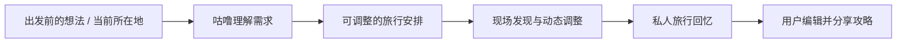

# Funny+ 产品书：让旅行中的每个选择，都有人帮你想一想

> **文档性质**：面向潜在合作伙伴的产品讨论稿，更新于 2026-11-13。产品处于建设阶段；本文将现有基础、MVP 目标与待验证主张分开说明，不代表所有能力已经上线。

## 一、我们是谁

Funny+ 是一款正在建设的 AI 旅行助理。咕噜是陪伴用户的旅行小帮手：从「想出去玩」到出行中临时改变主意，再到旅行结束后整理回忆，都能围绕同一趟旅行理解用户的处境，帮助用户比较选择、规划行动和避开已知问题。

**产品主张：出发前帮你规划，到了之后帮你发现，计划改变时帮你继续往下走。**

我们首先聚焦北京：验证半天至两天的出游规划，以及用户已经在目的地、需要安排接下来几小时的场景。之后是否扩展其他城市，以用户反馈和数据供给能力为依据。

## 二、为什么做：旅行不是一次性生成计划

一次旅行包含许多分散的决定：去哪里、先去哪、怎么走、值不值得排队、现在还有没有时间。出发前的信息不完整，到了现场又可能因为天气、体力、兴趣和交通改变。

| 时刻 | 用户的困难 | Funny+ 想解决的问题 |
| --- | --- | --- |
| 出发前 | 攻略分散，路线、开放时间、预算与同行人的需求需要自己拼起来 | 把自然语言需求变成可比较、可调整的计划，并说明依据与未知项。 |
| 已在目的地 | 不一定有详细计划，不知道附近什么适合此刻 | 结合用户提供的位置、剩余时间和偏好，推荐可执行的选择。 |
| 计划变化 | 景点不合心意、同行人累了，原计划不再适合 | 理解用户意图，比较下一站和交通，并解释对后续安排的影响。 |
| 旅行结束 | 照片、路线和体验分散，整理分享费时 | 保存私人旅行回忆，再由用户选择内容生成可编辑攻略。 |

以上是基于产品讨论的场景假设，尚需通过真实用户研究验证发生频率、痛点强度和付费意愿。

## 三、服务谁：既照顾计划，也照顾即兴

首批关注在北京有半天至两天自由时间、希望减少旅行决策负担的人。有人喜欢提前定路线，也有人到了当地再决定；同一个人也可能两种方式交替使用。产品不要求用户选择固定人格或模式。

- **提前规划**：「周末带爸妈去北京玩两天，不想走太多路。」咕噜理解同行人和节奏，提供可修改的计划。
- **临时决定**：「我在前门附近，下午还有四小时，想吃点东西。」咕噜结合可用信息给出候选；用户也可手动指定位置。
- **途中变化**：「这里没什么可玩的，去下一站吧。」咕噜帮助确认下一站，展示可获得的交通、时间与对后续安排的影响。

示例是目标体验，不保证当前版本已经具备全部能力。

## 四、产品怎么工作

**规划**：对话和结构化旅行工作台共同使用一份旅行上下文。用户可以固定重要安排，也可以保留灵活备选。

**发现**：用户计划了地点且位置与该地点匹配时，产品目标是在应用内主动展示相关推荐；不在该地点时先询问是否想看。定位不可用时可手动选择或确认。目标推荐覆盖美食、拍照点、特色及热门商品、游玩和避坑；首版实际类别取决于数据核验。

**调整**：咕噜提出变化，并说明已知的时间、费用和行程影响；影响已确认安排的修改由用户确认。数据不可用时明确说明。

**回忆与攻略**：用户为自己保存旅行卡片、照片和文字；结束后咕噜协助整理私人回顾。用户选择需要公开的内容，编辑并分享只读攻略，私人记录不自动公开。

## 五、同类产品对照

以下对照基于 2026-11-13 可访问的官方公开资料，描述的是各方公开能力和 Funny+ 的目标定位，并非全面功能实测；不同平台、地区和版本的实际体验可能不同。

| 类别与代表 | 公开资料中的能力或定位 | Funny+ 的产品选择 | 分析 |
| --- | --- | --- | --- |
| 综合旅行平台：携程 AI 行程助手 | 公开介绍行程规划、地图编辑、开放时间及交通信息和从规划到预订的服务。 | 以咕噜和一趟旅行的持续上下文组织规划、现场变化、回忆和攻略；MVP 暂不做交易。 | 携程在交易和供应链整合方面有明显基础。Funny+ 需要验证现场调整及连续体验是否能真正更贴合目标用户，不能仅凭接入 AI 宣称领先。 [携程 AI 行程助手](https://www.ctrip.com/tripplanner) |
| 旅行 AI 助手：TripGenie / Trip.Planner | 官方介绍个性化行程、旅途中帮助、预订等；Trip.Planner 面向行程规划与管理。 | 在北京样板场景重点探索「到达后发现」及「想离开时继续下一段」的交互。 | 竞品也覆盖行中服务，场景本身并非独家。差异需要依靠准确性、反馈速度与实际使用体验证明。 [TripGenie](https://www.trip.com/tripgenie)、[Trip.Planner](https://www.trip.com/newsroom/trip-com-launches-trip-planner-smart-itineraries-tailored-to-your-travel-style-with-real-time-recommendations/) |
| 地图与出行基础设施：高德地图 | 高德公开提供地点、路径及 AI 出行规划相关接口，支持将攻略导入地图并衔接导航等服务。 | 将地图能力作为可能的数据与出行基础，围绕用户整趟旅行提供解释、选择和调整。 | 地图平台的地点和路线能力是重要基础及潜在合作对象；Funny+ 的价值需体现在跨环节的决策体验。 [高德出行规划案例](https://developer.amap.com/api/mcp-server/application-case/travel-planning-case) |
| 攻略与内容社区 | 常见体验以搜索、浏览和用户内容为中心；不同平台能力差异很大。 | 用户从私人旅行记录中选择内容生成攻略，强调旅行经历与实用信息的衔接。 | 社区内容广度和用户规模是成熟平台的优势；Funny+ 尚未验证内容供给、分发与分享意愿。此行为类别分析，不代表对任何具体平台的完整评价。 |

## 六、我们希望形成的优势

以下是**产品假设及建设方向，不是已经证实的竞争优势**：

1. **围绕当下做决定**：推荐考虑时间、位置、同行人和既有安排，而非只有通用榜单。
2. **计划可以随着用户变化**：从「提前计划」自然过渡到「临时改主意」，并看见变化的影响。
3. **建议有依据，也承认不知道**：关键数据标记来源、时间和不确定性；未知票价不冒充免费。
4. **一趟旅行贯穿始终**：计划、现场调整、私人回忆与用户选择分享的攻略连接起来。
5. **用户保有控制权**：重要变更确认后应用；私人内容由用户选择是否公开。

是否形成实际优势，需要在样板城市通过用户任务完成率、推荐采纳、修改成功与分享意愿验证，并持续比较现有替代方案。

## 七、MVP 交付与验证

当前 MVP 是 A 版：重庆、成都、北京的 1–2 天出游。用户从发现进入，填写需求，比较方案，在行程工作台里改一天、看预算、路线和避坑，并保存到本机。咕噜可以对话生成方案，修改先给出预览，确认后才落到行程。定位到城市，用来选择出发城市。

先看用户能否独立走完这条链路：能不能看懂方案差别和费用依据，改完一天后能不能看懂影响，本机重新打开后行程还在不在。

到达判断、下一站、按剩余时间的临时安排、账号跨设备、旅行回忆和攻略分享不在这一版。讨论稿见 [AI Native MVP](ai-native-mvp.md)。实现状态见 [技术架构说明](funny-plus-technical-architecture.md)。

## 八、希望与伙伴共同探索

潜在合作方向包括北京本地地点及内容数据、地图与交通能力、餐饮与体验内容、真实用户试用及场景反馈。具体合作方式、数据使用授权、商业模式与推广标识均需另行讨论；本文不构成已达成合作或商业承诺。
