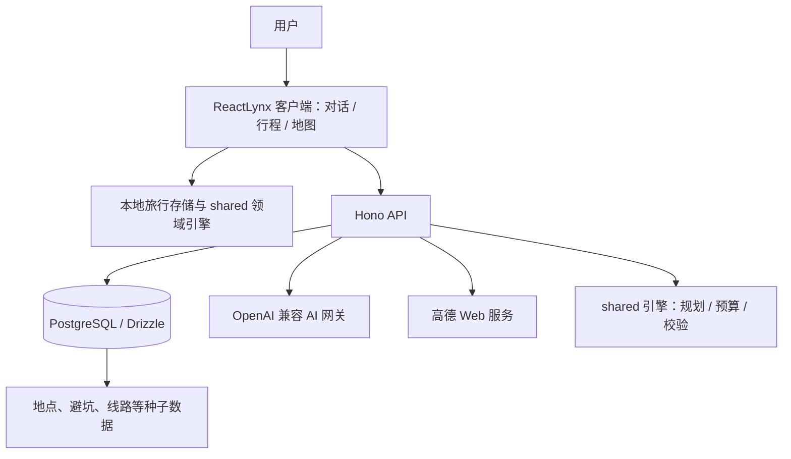
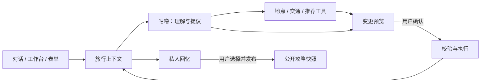

# Funny+ 技术架构：当前实现与 AI Native 演进

> **状态**：基于当前工作区代码的静态梳理，**更新于 2026-11-23（第二次对齐：账号同步、分享快照、AI 度量与评估、数据飞轮均已落地，原文 §3–§7 的多处「尚未实现」已过期）**；未以本次运行或线上环境验证部署与端到端行为。
>
> **阅读口径**：明确区分「当前实现」「代码或文档体现的选型理由」与「MVP 目标」。历史文档存在过时内容时，以本次读取的代码为准；未找到的决策理由标为推断。

## 一、架构概览

这是**当前主要依赖关系**，不是目标架构的完整实现。行程、回忆、攻略草稿都是「本机先写 → 推云端 → 登录时补推 + 拉回合并」，服务端 `trips` / `memories` / `guides` 三个路由都已读写（409 `stale_write` 处理并发写）。对话与表单两个入口生成的方案都会落成真实行程并进工作台，走的是同一份 `shared/engine`。

| 层 | 当前技术 | 主要职责 |
| --- | --- | --- |
| 客户端 | Lynx / ReactLynx、TypeScript，iOS 与 Android 宿主及 Web 预览 | 页面、交互、对话流、位置桥接、行程本地状态。 |
| 共享领域层 | `shared/types`、`shared/engine` | 定义旅行与地点类型，生成确定性计划，计算预算、校验约束、处理路线与避坑规则。 |
| API | Node.js、Hono、TypeScript | 提供内容、AI、地图、反馈、线路、示例行程等接口。 |
| 数据 | PostgreSQL、Drizzle、JSON 种子和迁移 | 持久化地点、内容、事实及部分设备级数据。 |
| 外部能力 | OpenAI 兼容 AI 网关、高德 Web 服务 | 模型对话与工具调用；逆地理、路径和地图等能力，依赖配置与服务可用性。 |

## 二、为什么采用这些技术

| 选择 | 项目中体现的理由 | 当前代价或边界 |
| --- | --- | --- |
| ReactLynx 跨端 UI | `PRODUCT.md` 定义一份 UI 代码覆盖 iOS、Android、Web，减少多端重复实现。 | 宿主与 Web 运行时能力不同；流式响应、定位和存储需要各端实测。 |
| TypeScript + shared 纯函数 | 领域类型和计算供客户端与服务端复用，减少两端口径漂移；引擎不依赖 DOM。 | 模块级地点索引等共享状态需要注意初始化和并发边界。 |
| Hono | 后端方案记载路由与内置 SSE 足够支撑当前服务，框架相对轻量。 | 复杂账号授权、后台任务和可靠性能力仍需自行建设。 |
| PostgreSQL + Drizzle | 后端方案强调 SQL 和迁移可读，适合结构化地点、事实及关系数据。 | 账号下的私人旅行读写已落地（24 张表）；当前**连库测试只能靠本机/compose 起库**，CI 里没跑，持久化层实际是零自动化验证。 |
| AI SDK + OpenAI 兼容网关 | 代码使用流式响应、工具调用及可配置网关；模型密钥留在服务端。 | 实际模型与网关可用性依赖部署配置；工具调用和输出质量需回归评估。 |
| 确定性规划与校验 | 用程序计算预算、时间和规则，保留证据、未知项及约束，减少模型凭空生成数字。 | 规则和数据覆盖仍有限。模型现在参与「挑哪些地点、什么顺序」（`POST /api/ai/plans`）与叙述生成，但**时刻、耗时、票价、校验一律不经过模型**。 |

这里的选型理由来自仓库文档、代码注释及职责归纳；不代表已经做过完整竞品基准测试或对所有替代技术的性能结论。

## 三、当前主流程

### 3.1 普通行程生成（表单主链路）

客户端收集 `Demand` 后打 `POST /api/ai/plans`：模型只在已收录地点里挑「去哪儿、先哪个」，返回一个 id 序列；`generatePlans(demand, { order })` 拿这个顺序去排，时刻、停留、路上耗时、预算、校验全部仍由 `shared/engine` 算。服务端与对话入口共用同一套两遍生成（第一遍定顺序、`warmRoutes` 预热路段后第二遍把到达时刻变准）。

**降级是彻底的**：`AI_API_KEY` 未配置、服务端不可用、6 秒超时、返回形状不对，一律落回本地 `planFor`，产出与没有模型时完全一致。`PlansResult` 同时给出 `by`（model/engine）与 `source`（server/local）—— 服务端的 engine 已经预热过路段，客户端不能再预热一次。

`Place.ticket = null` 表示票价未知，预算中应列为未核实，不等同免费。地点和事实带 `source`、`verifiedAt`、`trust` 等字段；硬冲突判定受数据可信状态约束。展示用评分和访问人数是录入值，不应当作真实统计数据。

### 3.2 咕噜对话

客户端 `lynx/src/aiChat.ts` 将消息、槽位和当前行程发给 `POST /api/ai/chat`，优先接收 SSE，运行时不支持时退回非流式。两条通道都把 `generatePlans` 和 `proposeRevise` 的结果交给同一份解析。`server/src/routes/ai.ts` 使用 AI SDK `streamText` 和 **12 个工具**：

1. `updateDemand` 收集结构化需求，当前要求目的地、天数、人数、预算档位齐全。
2. `queryPlaces` 查询地点池。`getPlaceDetail`、`getFacts`、`getBudget`、`listLines` 只读引擎里的营业、避坑、费用依据和班次。票价未核实保持空，不能说成免费。
3. `generatePlans` 调用共享引擎，返回完整方案，并把硬冲突放进 `checks`。有冲突最多再生成一版；第二次仍冲突就停，已保存行程不动。用户选定后经 `onPlanned` 写入当前行程并打开行程页。
4. `proposeRevise` 把用户原话交给 `resolveRevision`，与行程页的 `POST /api/ai/revise` 是同一个函数。返回的是待确认预览；用户点确认后才写入，取消则原行程不动。支持**时段粒度**（`ReviseOp.ease` + `window`）：「第二天下午轻松点」只动下午；带 `pinned` 标记的固定安排会被拒绝删改并说明原因。
5. `validatePlan` 检查当前行程的硬冲突，不接受模型自己写的计划。
6. 现场相关工具：`nearbyPlaces`（按定位与类别找吃/拍/玩）、`transportFor`（线路班次与打车建议）、`nextStop`（下一站候选）。到达判定在 `shared/engine/onSite.ts`，只回答「能不能判定」，精度不足/坐标缺失一律 `unknown` 交给用户确认，**不假定到达**。
7. `memory-narrative` 是独立入口：把整趟回忆整理成叙述段落，确定性草稿（`shared/engine/memoryDraft.ts`）作为兜底与基线。

模型通过服务端配置的 OpenAI 兼容网关调用；代码提供默认模型及环境变量覆盖，实际启用与否取决于配置。提示词要求数字只复述工具字段，这仍不是可证明的输出保证。

对话会话已上云（G6）：登录后客户端只传 `sessionId + 本轮输入`，历史由服务端 `ai_sessions` / `ai_messages` 持有，换设备能接着聊；匿名时退回本机 `funny-plus.chat.v1`。历史只回文本，未确认的预览卡**不会跨设备复活成可确认状态**。

### 3.3 定位和地图

`lynx/src/geo.ts` 与宿主桥接定位状态，服务端 `routes/geo.ts` 提供地图相关代理能力；密钥由服务端配置，客户端只拿到结果。

到达判定在 `shared/engine/onSite.ts`：默认到达半径 300 米，定位精度超过阈值就不判到达。三分支（匹配 → 建议推荐 / 不匹配 → 先询问 / 定位不可用 → 手动指定或确认到达）的口径是「定位推断与用户确认分开记录」，所以引擎只回答「能不能判定」，从不替用户下结论。**无后台持续定位、无推送**。

现场推荐的数据供给仍然是短板：`data/facts.json` 的 `poiGroup` 只有 `pitfall` / `access`，吃 / 拍 / 买条目基本为零，真实城市班次也缺。代码路径是通的，内容层是空的 —— 界面会如实说「暂无推荐」，不会编。

### 3.4 保存与身份

**本机优先、云端补齐**。`lynx/src/storage.ts` 在宿主桥、浏览器存储、IndexedDB 和内存之间选择可用路径；写成功后再推云端，登录时补推本机数据并拉回云端数据做一次合并（`lynx/src/syncMerge.ts`）。服务端 `trips` / `memories` / `guides` / `photos` 都要求登录，`clientId` 只用于匿名并账的认领，**不作为已登录数据的访问凭证**。并发写用 `updatedAt` 比较，客户端数据更旧时返回 409 `stale_write`，由界面提示，不静默覆盖。

登录三通道：手机号短信（阿里云短信）、微信、一键登录（`routes/auth.ts` + `auth/providers.ts`）。会话 30 天 TTL，续期有 5 分钟节流；短信有重发冷却与尝试次数上限。**手机号是账号合并的锚点**：先用微信登录、再用短信登录同一手机号，会落到同一账号（`auth/merge.ts`）。未配置的服务商由 `/api/auth/status` 报出来，界面隐藏对应入口，不假装可用。

攻略分享走**快照**：发布时冻结一份只读快照并签发 `randomBytes(16)` 的 token（`sync/shareSnapshot.ts` 白名单过滤，只留 remote 照片）；同一草稿再发布是幂等的 —— 刷新快照、token 不变，所以链接不会失效；撤回后 JSON 接口 404，再发布必须换新 token（否则撤回等于摆设）。

## 四、数据与部署现状

`data/` 中的地点、城市、攻略、避坑与线路等 JSON 由种子流程导入数据库，同时**也打进客户端包**作为离线兜底（内容层双源，见 §5）。`server/drizzle/` 保存迁移。`server/src/db/schema.ts` 一张文件定义 **24 张表**：内容（places / facts / lines / cities / guides / plays）、账号（users / authSessions / smsCodes）、用户数据（trips / tripVersions / tripMemories / guideDrafts / guideShares / photos / collections / footprints）、运营（dataSubmissions / constraintReports / factFeedbacks / trackEvents / aiCalls / aiSessions / aiMessages）。

数据库连接与外部凭证统一走 `server/src/env.ts`，路由不直接摸 `process.env`（例外：`ai/cost.ts` 的价目表按模型名动态读）。口径上把「没配」和「配错」分开：没配返回 503 + code，前端据此降级；配错把服务商原始错误码透出来。

照片存**本机磁盘**（`server/src/sync/storage.ts`，`MEDIA_DIR`，路径由 id 推导，按 `sha256` 同人同图去重）。单实例可行，容器重建即丢，换对象存储要动这一处。

### 4.1 可观测性

- **AI 调用度量**：`ai_calls` 表 + `server/src/ai/observe.ts` 写入，口径集中在 `server/src/ai/metrics.ts`（纯函数，可测）。`npm run metrics` 打印漏斗、工具成功率、p95 延迟、token 与成本（`ai/cost.ts` 按模型价目表折算 micros）。
- **提示词版本**：`PROMPT_VERSION` 随每次调用落库，可按版本比较降级率与采纳率。
- **对话回归集**：`server/src/ai/eval/`（6 类用例 + SSE runner），`npm run eval:chat` 跑通过率，支持 `--save` / `--baseline` / `--only`。**前提是另开终端跑着 `dev:api`**。
- **客户端埋点**：`lynx/src/track.ts` 32 个事件批量上报 `track_events`，带 `journey` 字段区分验收旅程。

### 4.2 数据可信与维护

`trust` 四档（official / credible / experience / pending）。展示层的两条兜底：随包快照的 `official` 一律降一档显示并标「随包快照 · 未与服务端核对」（`displayTrust` / `originNote`）；反馈与有效期按 `server/src/data/trustRules.ts` 的阈值把可信度**再降一档**并写 `trustNote` 上屏（阈值集中在一个文件，是产品口径）。

补录生效（C2）的四个限制写死在 `routes/submit.ts`：字段白名单、只在原列为空时写、写进去同时把该行压到「用户填报」档、**匿名设备票不凑数**（至少一个登录账号背书）。生效后调 `invalidateEngine()` 让 AI 侧重新装载（见 §5 第一条）。

仓库提供数据库 Docker Compose、服务端开发脚本及客户端构建脚本。历史后端文档提出单机 Compose 与反向代理的部署思路，**未在本次核实生产部署**，不能将其当作当前线上事实。

## 五、已知限制与风险

上一版这里是「A 版 vs 下一阶段」的差距表，多数条目已经落地（账号与同步、分享快照、图文回忆、AI 度量与回归集）。下面只留**当前真实存在**的问题，按严重度排。

| 范围 | 现状 | 影响 |
| --- | --- | --- |
| 引擎缓存与数据维护 | `routes/ai.ts` 的 `ensureEngine` 把 places / lines 灌进进程级单例，整个进程不刷新。补录生效会写这两张表 | 已加**代次失效**（`server/src/engineCache.ts`）：补录写完调 `invalidateEngine()`，下一次 AI 请求重新装载。但 `db:seed` 之后**仍需重启进程**才生效 —— 种子是独立进程，没有失效通道 |
| AI 接口鉴权 | `/api/ai/chat`、`/plans`、`/revise`、`/memory-narrative` **全部匿名可调** | 无鉴权、无限流、无配额。有成本度量（`ai/cost.ts`）但没有事前约束：谁拿到地址都能刷 token；跑批脚本一旦指向线上地址就是无限制烧钱 |
| 持久化层验证 | 20 个测试文件里 5 个连库。库起着时全绿（253 例），**库没起时这 5 个文件全红**，而且没有人会因此拦住提交 | 跨设备并账、分享快照幂等、409 `stale_write` 这些最需要回归的地方，验证强度取决于「本机恰好开着库」。`server/docker-compose.yml` 已写好，缺的是把它接进 CI 或 pre-push |
| 分层 | 16 个路由里 14 个直接 `import { db }`，无 service 层 | 业务规则（归属校验、去重、409 口径）散在 handler，`eval` / 脚本复用不了；改一条规则要 grep 全仓 |
| 单文件体量 | `server/src/routes/ai.ts` 974 行（`/chat` 单个 handler 约 500 行）；`lynx/src/pages/MapPage/index.tsx` 989 行 | 纯函数已拆进 `server/src/ai/`，路由与页面没拆。工具面（12 个）与提示词装配仍在路由文件里 |
| 内容层双源 | 客户端从随包 `data/*.json` 起手，接口回来再覆盖 | `displayTrust` / `originNote` 只兜住了 trust 标签，**数值（营业时段、票价）没有对应机制**：随包副本过期时，避坑页标着「随包快照」而行程页用的是另一份数字 |
| 现场数据供给 | `poiGroup` 只有 pitfall / access；真实城市班次缺 | 到达判定、下一站、现场推荐的**代码路径是通的，内容层基本为空**。界面如实说「暂无推荐」 |
| 媒体存储 | 照片存本机磁盘 | 单实例可行；多实例或容器重建即丢。换对象存储要同时动 `storage.ts` 与 `photoUrl` 的 `publicBase` 耦合 |
| 共享类型 | `shared/types/index.ts` 791 行单一 barrel，71 个文件引用 | 任何字段改动命中 71 个引用点，没有按域切分 |

## 六、演进方向（已实现的部分已移出本节）

旅行现在是用户和咕噜共享的状态：计划、已确认经历、偏好、数据来源与用户操作彼此区分。模型负责理解和提案；工具提供带来源的事实；领域系统计算、校验，并在用户确认后执行必要变更。**这条闭环已落地**，剩下的差距是数据供给与运营能力，不是架构形状。

按当前代码，下一步真正待做的只有四块：

1. **数据供给**：吃 / 拍 / 买 POI、真实班次、北京数据补齐。没有数据，现场推荐与下一站做出来是空壳。
2. **运营与安全**：AI 接口鉴权与限流、日预算上限；持久化层进 CI。
3. **账号边界**：微信 / Apple 通道的真实兑换（现在服务端有通道、缺 AppID 与 Apple 能力配置）；`users.wechatUnionid` / `appleSub` 仍零写入。
4. **工程债**：`routes/ai.ts` 抽 `tools.ts`、`shared/types` 按域拆、媒体换对象存储。

## 七、代码索引

| 内容 | 路径 |
| --- | --- |
| 产品方向与 MVP | `PRODUCT.md`、`docs/ai-native-mvp.md`、`docs/spec-ai-native-gap.md`（差距台账） |
| 客户端与页面 | `lynx/src/App/index.tsx`、`lynx/src/App/subPages.tsx`、`lynx/src/pages/` |
| 客户端状态 | `lynx/src/App/useTrips.ts`、`useGuides.ts`、`useAuth.ts`、`useContent.ts`、`useBootstrap.ts` |
| 对话客户端与服务端 | `lynx/src/aiChat.ts`、`lynx/src/planFetch.ts`、`server/src/routes/ai.ts`、`server/src/ai/` |
| AI 纯函数 | `server/src/ai/{prompt,chatPrompt,slots,propose,revise,narrate,cost,metrics,observe,routeWarm,model}.ts` |
| AI 回归集 | `server/src/ai/eval/`、`server/scripts/chat-eval.ts` |
| 领域类型与引擎 | `shared/types/index.ts`、`shared/engine/`（planner / planEdit / budget / validate / lines / facts / placeIndex / opening / timeWindow / dayDate / lightPlan / onSite / memoryDraft / aiGround） |
| 存储与同步 | `lynx/src/storage.ts`、`lynx/src/sync.ts`、`lynx/src/syncMerge.ts`、`server/src/routes/{trips,memories,guides}.ts` |
| 身份 | `lynx/src/apiAuth.ts`、`lynx/src/App/useAuth.ts`、`server/src/routes/auth.ts`、`server/src/auth/` |
| 分享与快照 | `server/src/routes/{guides,share,shareShell}.ts`、`server/src/sync/shareSnapshot.ts` |
| 媒体 | `lynx/src/photo.ts`、`server/src/routes/photos.ts`、`server/src/sync/storage.ts` |
| 数据可信与飞轮 | `server/src/data/trustRules.ts`、`server/src/routes/{facts,submit}.ts` |
| 引擎缓存失效 | `server/src/engineCache.ts` |
| 位置和地图 | `lynx/src/geo.ts`、`lynx/src/hostBridge.ts`、`server/src/routes/geo.ts` |
| 数据与迁移 | `data/`、`server/src/db/schema.ts`、`server/src/db/seed.ts`、`server/drizzle/` |
| 脚本 | `scripts/verify-amap.ts`、`server/scripts/{ai-metrics,chat-eval}.ts` |

## 八、Lynx 跨端与原生能力架构（2026-11-16 工作区核对）

**目标**：共用 ReactLynx 界面、TypeScript 业务和服务端能力，分别构建 iOS 和 Android 应用；平台系统能力通过统一接口调用，由平台实现或可用插件提供。分别打包、签名和测试，不能假设所有浏览器 API 或所有插件跨端可用。[Lynx 官方 Native Modules](https://lynxjs.org/3.6/guide/use-native-modules.html)

| 层级 | 内容 | 复用与边界 |
| --- | --- | --- |
| 产品界面 | 首页、咕噜对话、旅行工作台、回忆与攻略 | ReactLynx 主要共用；安全区、键盘、字体和交互需两端验证。 |
| 业务与领域 | 旅行状态、推荐规则、到达判断、预算与校验 | TypeScript 尽可能共用；实时位置与外部事实通过接口取得。 |
| 平台能力接口 | 定位、照片选择、分享、登录、通知、安全存储 | 定义统一类型、权限、错误、取消与生命周期约定；实现可用原生模块或验证过的插件，接口本身为目标设计。 |
| 系统宿主 | iOS 和 Android App、系统 SDK、授权与回调 | 各端独立接入和配置；平台能力可复用既有插件，不意味着全部自行开发。 |
| 后端与数据 | 账号、行程、模型、地图数据及媒体 | 两端共用服务；身份鉴权、媒体和正式云同步仍待建设。 |

### 8.1 当前两端宿主：以工作区为准

2026-11-16：iOS `SceneDelegate` 选择 `LynxHostController`（Swift），通过原生 LynxView 加载 `main.lynx.bundle`。旧的 WKWebView 路径留在 `WebHostController`，不是根控制器。Android `MainActivity`（Kotlin）同样是原生 LynxView，并注入 API 地址。两端宿主源码已分别是 Swift 和 Kotlin；Lynx SDK 本身仍是 Objective-C / Java。本次核对了源码并编译了 Android Kotlin 与 iOS 模拟器工程，没有在真机上跑定位、网络和权限。部分更早的 README 仍按 WebView 来写，不能当作当前入口。

**更正上一版分析**：Android 的 WebView 同源代理拒绝非 GET 是旧实现的限制；不能据此判断当前工作区的原生 Lynx 宿主仍然返回 405。现在需要实际验证新宿主的 POST、AI 流式请求、网络权限与两端行为；本次未运行真机或模拟器。

### 8.2 定位：平台获取，业务共享

- iOS：`LocationHub` 使用 Core Location 的前台授权与单次请求，当前设置 `kCLLocationAccuracyKilometer`；结果经 `FPBridge` / `globalProps` 进入 Lynx。此精度配置以城市级为目标，不能假设可判断景点或店铺到达。
- Android：`MainActivity` 声明粗/精定位，拿一次坐标（5 分钟内的缓存优先），用 `updateGlobalProps` 和 `sendGlobalEvent("__fpLocation")` 下发。清单里的权限还在。这是源码行为，本次没有在模拟器里点过授权弹窗。
- 共享层：`lynx/src/hostBridge.ts` 和 `geo.ts` 读取宿主位置快照，处理状态并支持城市解析。到达判断、推荐频率与手动确认仍需实现和验证。

下一阶段建议：用户打开应用时按需请求前台位置；位置不可用、过期或精度不足时允许手动指定地点或确认到达。结合地点范围、准确度及时间判断是否可能到达，再展示或询问推荐；后台持续定位和推送单独评估。位置权限的具体提示、使用与保留规则需与实际用途一致。

### 8.3 推荐的平台能力优先级

1. 第一阶段：验证两端原生宿主网络 POST / SSE、错误处理和版本兼容；定义定位接口并补齐 Android 定位、权限及手动降级。
2. MVP 闭环：接入账号登录与安全存储、相册选择及上传、系统分享和攻略链接，分别测试授权、拒绝、取消与回调。
3. 按用户验证结果评估：交互式地图、后台到达、通知和语音。各端是否采用原生 SDK 或插件、数据授权和发布要求需逐项确认。

定位接口示例为设计草案，不代表已实现：`getCurrentPosition()` 返回成功时的坐标、精度、时间，以及拒绝、不可用、超时等状态。权限查询、取消和持续监听是否需要单独接口，待详细设计。

### 8.4 平台适配语言决策

**已确认的目标方向**：iOS 平台适配使用 Swift；Android 平台适配使用 Kotlin。ReactLynx 界面、TypeScript 业务逻辑和统一平台接口继续共用。系统能力可通过原生实现或经验证的插件接入。

**当前状态**：iOS 宿主源码是 Swift，Android 宿主源码是 Kotlin。Lynx iOS / Android SDK 仍分别是 Objective-C 和 Java，宿主通过它们的现有 API 接。

互操作上留了一处 Objective-C：`LynxHostClient`。`LynxViewClient` 继承的资源加载方法是 required，Swift 一旦声明遵循就必须实现，而 `setClient:` 会把 client 同时赋给 `resourceFetcher`。实现了这个方法，资源请求就会进空实现。ObjC 可以只接 `didRecieveError:`，required 方法保持未实现，和迁移前一样。

`<input>` 的属性注册写在 Swift 类本体上，方法名沿用 `LYNX_PROP_SETTER` 展开后的 `__lynx_prop_config__` 前缀，供 `LynxPropsProcessor` 扫描。SVG 解码是 Swift 分类挂在 `LynxImageService` 上。Android 的 SVG 仍挂在 Fresco 解码层（`FPSvgDecoder`）。

构建：Android `compileDebugKotlin` 已通过；iOS `FunnyPlus` scheme 的 Debug 模拟器构建已通过。真机上的网络、定位和权限还没有在这次迁移里重跑。
