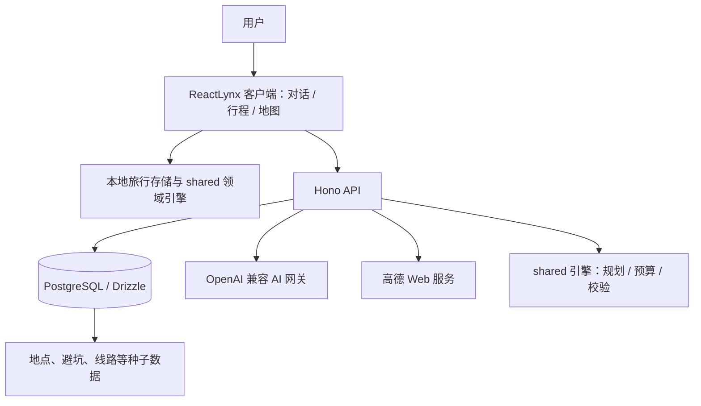
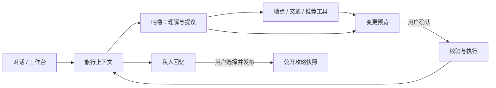

# Funny+ 技术架构：当前实现与 AI Native 演进

> **状态**：基于当前工作区代码的静态梳理，更新于 2026-11-13；未以本次运行或线上环境验证服务配置与端到端行为。工作区含未提交改动，本说明反映本次查看时的代码，不等同于已发布版本。
>
> **阅读口径**：明确区分「当前实现」「代码或文档体现的选型理由」与「MVP 目标」。历史文档存在过时内容时，以本次读取的代码为准；未找到的决策理由标为推断。

## 一、架构概览

这是**当前主要依赖关系**，不是目标架构的完整实现。用户行程目前主要在客户端保存；服务端行程路由只读。AI 对话可调用本地共享的确定性规划引擎，但生成的完整行程尚未从对话贯通到工作台。

| 层 | 当前技术 | 主要职责 |
| --- | --- | --- |
| 客户端 | Lynx / ReactLynx、TypeScript，iOS 与 Android 宿主及 Web 预览 | 页面、交互、对话流、位置桥接、行程本地状态。 |
| 共享领域层 | `shared/types`、`shared/engine` | 定义旅行与地点类型，生成确定性计划，计算预算、校验约束、处理路线与避坑规则。 |
| API | Node.js、Hono、TypeScript | 提供内容、AI、地图、反馈、线路、示例行程等接口。 |
| 数据 | PostgreSQL、Drizzle、JSON 种子和迁移 | 持久化地点、内容、事实及部分设备级数据。 |
| 外部能力 | OpenAI 兼容 AI 网关、高德 Web 服务 | 模型对话与工具调用；逆地理、路径和地图等能力，依赖配置与服务可用性。 |

## 二、为什么采用这些技术

| 选择 | 项目中体现的理由 | 当前代价或边界 |
| --- | --- | --- |
| ReactLynx 跨端 UI | `PRODUCT.md` 定义一份 UI 代码覆盖 iOS、Android、Web，减少多端重复实现。 | 宿主与 Web 运行时能力不同；流式响应、定位和存储需要各端实测。 |
| TypeScript + shared 纯函数 | 领域类型和计算供客户端与服务端复用，减少两端口径漂移；引擎不依赖 DOM。 | 模块级地点索引等共享状态需要注意初始化和并发边界。 |
| Hono | 后端方案记载路由与内置 SSE 足够支撑当前服务，框架相对轻量。 | 复杂账号授权、后台任务和可靠性能力仍需自行建设。 |
| PostgreSQL + Drizzle | 后端方案强调 SQL 和迁移可读，适合结构化地点、事实及关系数据。 | 当前模式与鉴权尚不能支撑正式账号下的私人旅行读写。 |
| AI SDK + OpenAI 兼容网关 | 代码使用流式响应、工具调用及可配置网关；模型密钥留在服务端。 | 实际模型与网关可用性依赖部署配置；工具调用和输出质量需回归评估。 |
| 确定性规划与校验 | 用程序计算预算、时间和规则，保留证据、未知项及约束，减少模型凭空生成数字。 | 规则和数据覆盖有限；当前 AI 主要收集需求，并非已实现模型驱动的动态规划。 |

这里的选型理由来自仓库文档、代码注释及职责归纳；不代表已经做过完整竞品基准测试或对所有替代技术的性能结论。

## 三、当前主流程

### 3.1 普通行程生成

客户端收集 `Demand`，使用共享地点索引与 `generatePlans` 生成不同节奏或交通方案；`budget.ts` 与 `validate.ts` 负责费用估算和规则检查。路线耗时可由地图服务预热，缺失时退回直线折算，并在数据中区分来源。

`Place.ticket = null` 表示票价未知，预算中应列为未核实，不等同免费。地点和事实带 `source`、`verifiedAt`、`trust` 等字段；硬冲突判定受数据可信状态约束。展示用评分和访问人数是录入值，不应当作真实统计数据。

### 3.2 咕噜对话

客户端 `lynx/src/aiChat.ts` 将消息、槽位和当前行程发给 `POST /api/ai/chat`，优先接收 SSE，运行时不支持时退回非流式。两条通道都把 `generatePlans` 和 `proposeRevise` 的结果交给同一份解析。`server/src/routes/ai.ts` 使用 AI SDK `streamText` 和工具：

1. `updateDemand` 收集结构化需求，当前要求目的地、天数、人数、预算档位齐全。
2. `queryPlaces` 查询地点池。`getPlaceDetail`、`getFacts`、`getBudget`、`listLines` 只读引擎里的营业、避坑、费用依据和班次。票价未核实保持空，不能说成免费。
3. `generatePlans` 调用共享引擎，返回完整方案，并把硬冲突放进 `checks`。有冲突最多再生成一版；第二次仍冲突就停，已保存行程不动。用户选定后经 `onPlanned` 写入当前行程并打开行程页。
4. `proposeRevise` 把用户原话交给 `resolveRevision`，与行程页的 `POST /api/ai/revise` 是同一个函数。返回的是待确认预览；用户点确认后才写入，取消则原行程不动。
5. `validatePlan` 检查当前行程的硬冲突，不接受模型自己写的计划。

模型通过服务端配置的 OpenAI 兼容网关调用；代码提供默认模型及环境变量覆盖，实际启用与否取决于配置。提示词要求数字只复述工具字段，这仍不是可证明的输出保证。

对话文字按行程存在本机（`funny-plus.chat.v1`）。再次进入能看到上次说过的话，方案卡片不重复挂，行程以工作台为准。换设备仍找不到这段对话。

### 3.3 定位和地图

`lynx/src/geo.ts` 与宿主桥接定位状态，服务端 `routes/geo.ts` 提供地图相关代理能力；密钥由服务端配置。不可用时存在状态提示或估算退路。当前代码存在宿主运行时适配限制，不能据此宣称各端定位与现场到达判断已经完整可用。

### 3.4 保存与身份

`lynx/src/storage.ts` 在宿主桥、浏览器存储、IndexedDB 和内存等可用路径间选择，本机行程并非账号云档案。`routes/auth.ts` 是登录通道占位，兑换流程未实现；`routes/trips.ts` 只读取示例及设备测试行程，未提供用户行程云写入。部分设备级接口使用 `clientId`，不应作为正式账号鉴权。

## 四、数据与部署现状

`data/` 中的地点、城市、攻略、避坑与线路等 JSON 由种子流程导入数据库；`server/drizzle/` 保存迁移。`server/src/db/schema.ts` 定义当前表结构。数据库连接和外部凭证来自服务端环境配置；密钥不应进入客户端或文档。

仓库提供数据库 Docker Compose、服务端开发脚本及客户端构建脚本。历史后端文档提出单机 Compose 与反向代理的部署思路，**未在本次核实生产部署**，不能将其当作当前线上事实。

## 五、已知限制与风险

当前 MVP 是 A 版：三个城市的 1–2 天计划、本机保存、城市级定位。下表是相对下一阶段的限制，不是这一版的验收缺口。

| 范围 | 当前限制 | 对下一阶段的影响 |
| --- | --- | --- |
| 旅行上下文 | 对话生成的完整方案和确认后的修改会写入当前行程；对话文字存在本机，换设备找不到。 | 需要账号下的会话同步。 |
| 灵活规划 | 槽位要求固定，现有 `Demand` 偏完整行程。 | 当地数小时临时规划需要允许缺省与逐步补充。 |
| 身份与访问 | 登录占位，设备标识非认证，用户行程无云端写入。 | 正式账号、鉴权、跨设备同步必须实现。 |
| 事实与数据 | 北京数据存在，但餐饮、拍照、商品及实时信息覆盖未核验；部分票价未知。 | 必须盘点来源、时效、许可和缺口；不能宣称实时或全面。 |
| 行中状态 | 存在定位基础，尚未确认地点到达、状态与推荐联动闭环。 | 需要定位精度、手动确认和隐私控制。 |
| 回忆与分享 | 尚无完整图文回忆、攻略快照和对外分享实现。 | 需要媒体存储、权限、撤销与内容治理设计。 |
| 评估 | 当前代码对完整 AI 质量、用户任务与回归覆盖的能力未作全面审计。 | 需建立样例、指标和故障观测，不能仅依赖提示词。 |

## 六、下一阶段目标架构（方案，尚未实现）

旅行成为用户和咕噜共享的状态：计划、已确认经历、偏好、数据来源与用户操作彼此区分。模型负责理解和提案；工具提供带来源的事实；领域系统计算、校验，并在用户确认后执行必要变更。

建议按纵向切片推进：①完整方案进入工作台及修改确认；②北京样板的到达推荐与下一站；③临时规划与位置；④账号、鉴权与云端同步；⑤图文回忆与攻略分享。数据盘点和 AI 评估从第一阶段开始。阶段顺序用于验证，不代表这些能力已实现或最终技术方案已定。

关键设计待定：登录方式、账号数据迁移、跨设备并发冲突、位置匹配和授权、推荐数据与费用、图片存储、分享权限及撤销、事实粒度、评估和运行监控。对外提供服务前需逐项验证。

## 七、代码索引

| 内容 | 路径 |
| --- | --- |
| 产品方向与 MVP | `PRODUCT.md`、`docs/ai-native-mvp.md` |
| 客户端与页面 | `lynx/src/App/index.tsx`、`lynx/src/pages/` |
| 对话客户端与服务端 | `lynx/src/aiChat.ts`、`server/src/routes/ai.ts`、`server/src/ai/model.ts` |
| 领域类型与引擎 | `shared/types/index.ts`、`shared/engine/` |
| 存储和身份 | `lynx/src/storage.ts`、`server/src/routes/auth.ts`、`server/src/routes/trips.ts` |
| 位置和地图 | `lynx/src/geo.ts`、`lynx/src/hostBridge.ts`、`server/src/routes/geo.ts` |
| 数据与迁移 | `data/`、`server/src/db/schema.ts`、`server/src/db/seed.ts`、`server/drizzle/` |

## 八、Lynx 跨端与原生能力架构（2026-11-16 工作区核对）

**目标**：共用 ReactLynx 界面、TypeScript 业务和服务端能力，分别构建 iOS 和 Android 应用；平台系统能力通过统一接口调用，由平台实现或可用插件提供。分别打包、签名和测试，不能假设所有浏览器 API 或所有插件跨端可用。[Lynx 官方 Native Modules](https://lynxjs.org/3.6/guide/use-native-modules.html)

| 层级 | 内容 | 复用与边界 |
| --- | --- | --- |
| 产品界面 | 首页、咕噜对话、旅行工作台、回忆与攻略 | ReactLynx 主要共用；安全区、键盘、字体和交互需两端验证。 |
| 业务与领域 | 旅行状态、推荐规则、到达判断、预算与校验 | TypeScript 尽可能共用；实时位置与外部事实通过接口取得。 |
| 平台能力接口 | 定位、照片选择、分享、登录、通知、安全存储 | 定义统一类型、权限、错误、取消与生命周期约定；实现可用原生模块或验证过的插件，接口本身为目标设计。 |
| 系统宿主 | iOS 和 Android App、系统 SDK、授权与回调 | 各端独立接入和配置；平台能力可复用既有插件，不意味着全部自行开发。 |
| 后端与数据 | 账号、行程、模型、地图数据及媒体 | 两端共用服务；身份鉴权、媒体和正式云同步仍待建设。 |

### 8.1 当前两端宿主：以工作区为准

2026-11-16：iOS `SceneDelegate` 选择 `LynxHostController`（Swift），通过原生 LynxView 加载 `main.lynx.bundle`。旧的 WKWebView 路径留在 `WebHostController`，不是根控制器。Android `MainActivity`（Kotlin）同样是原生 LynxView，并注入 API 地址。两端宿主源码已分别是 Swift 和 Kotlin；Lynx SDK 本身仍是 Objective-C / Java。本次核对了源码并编译了 Android Kotlin 与 iOS 模拟器工程，没有在真机上跑定位、网络和权限。部分更早的 README 仍按 WebView 来写，不能当作当前入口。

**更正上一版分析**：Android 的 WebView 同源代理拒绝非 GET 是旧实现的限制；不能据此判断当前工作区的原生 Lynx 宿主仍然返回 405。现在需要实际验证新宿主的 POST、AI 流式请求、网络权限与两端行为；本次未运行真机或模拟器。

### 8.2 定位：平台获取，业务共享

- iOS：`LocationHub` 使用 Core Location 的前台授权与单次请求，当前设置 `kCLLocationAccuracyKilometer`；结果经 `FPBridge` / `globalProps` 进入 Lynx。此精度配置以城市级为目标，不能假设可判断景点或店铺到达。
- Android：`MainActivity` 声明粗/精定位，拿一次坐标（5 分钟内的缓存优先），用 `updateGlobalProps` 和 `sendGlobalEvent("__fpLocation")` 下发。清单里的权限还在。这是源码行为，本次没有在模拟器里点过授权弹窗。
- 共享层：`lynx/src/hostBridge.ts` 和 `geo.ts` 读取宿主位置快照，处理状态并支持城市解析。到达判断、推荐频率与手动确认仍需实现和验证。

下一阶段建议：用户打开应用时按需请求前台位置；位置不可用、过期或精度不足时允许手动指定地点或确认到达。结合地点范围、准确度及时间判断是否可能到达，再展示或询问推荐；后台持续定位和推送单独评估。位置权限的具体提示、使用与保留规则需与实际用途一致。

### 8.3 推荐的平台能力优先级

1. 第一阶段：验证两端原生宿主网络 POST / SSE、错误处理和版本兼容；定义定位接口并补齐 Android 定位、权限及手动降级。
2. MVP 闭环：接入账号登录与安全存储、相册选择及上传、系统分享和攻略链接，分别测试授权、拒绝、取消与回调。
3. 按用户验证结果评估：交互式地图、后台到达、通知和语音。各端是否采用原生 SDK 或插件、数据授权和发布要求需逐项确认。

定位接口示例为设计草案，不代表已实现：`getCurrentPosition()` 返回成功时的坐标、精度、时间，以及拒绝、不可用、超时等状态。权限查询、取消和持续监听是否需要单独接口，待详细设计。

### 8.4 平台适配语言决策

**已确认的目标方向**：iOS 平台适配使用 Swift；Android 平台适配使用 Kotlin。ReactLynx 界面、TypeScript 业务逻辑和统一平台接口继续共用。系统能力可通过原生实现或经验证的插件接入。

**当前状态**：iOS 宿主源码是 Swift，Android 宿主源码是 Kotlin。Lynx iOS / Android SDK 仍分别是 Objective-C 和 Java，宿主通过它们的现有 API 接。

互操作上留了一处 Objective-C：`LynxHostClient`。`LynxViewClient` 继承的资源加载方法是 required，Swift 一旦声明遵循就必须实现，而 `setClient:` 会把 client 同时赋给 `resourceFetcher`。实现了这个方法，资源请求就会进空实现。ObjC 可以只接 `didRecieveError:`，required 方法保持未实现，和迁移前一样。

`<input>` 的属性注册写在 Swift 类本体上，方法名沿用 `LYNX_PROP_SETTER` 展开后的 `__lynx_prop_config__` 前缀，供 `LynxPropsProcessor` 扫描。SVG 解码是 Swift 分类挂在 `LynxImageService` 上。Android 的 SVG 仍挂在 Fresco 解码层（`FPSvgDecoder`）。

构建：Android `compileDebugKotlin` 已通过；iOS `FunnyPlus` scheme 的 Debug 模拟器构建已通过。真机上的网络、定位和权限还没有在这次迁移里重跑。
